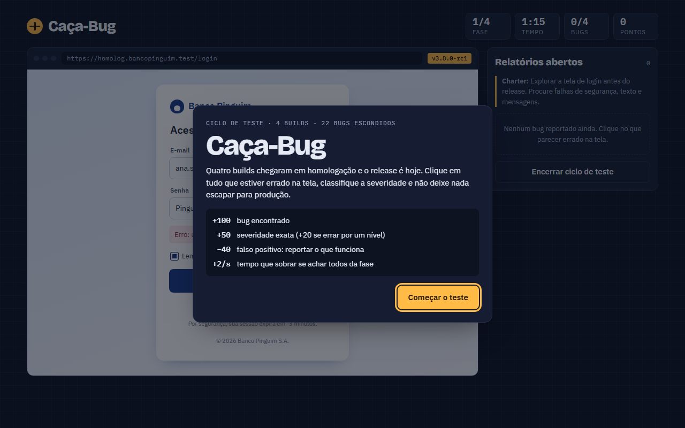

# 🐞 Caça-Bug

Um jogo em que você é o QA: quatro builds chegaram em homologação, o release é hoje e os bugs estão escondidos na tela.

**[▶ Jogar agora](https://danielnaasson.github.io/caca-bug/)**

## Como funciona

Cada fase é uma tela de um sistema fictício, com um charter de teste e um tempo limite. Clique no que estiver errado e classifique a severidade.

| Ação | Pontos |
|---|---|
| Bug encontrado | +100 |
| Severidade exata | +50 (+20 se errar por um nível) |
| Falso positivo | −40 |
| Tempo restante, se achar todos da fase | +2 por segundo |

São 4 builds e 22 bugs, de erro de texto a falha de segurança. Os nomes e documentos que aparecem no jogo são inventados.

## Testes

O jogo tem uma suíte E2E própria em Cypress: **[caca-bug-e2e](https://github.com/danielnaasson/caca-bug-e2e)**.

## Tecnologia

Um único `index.html` com HTML, CSS e JavaScript puros, sem build e sem dependências.
